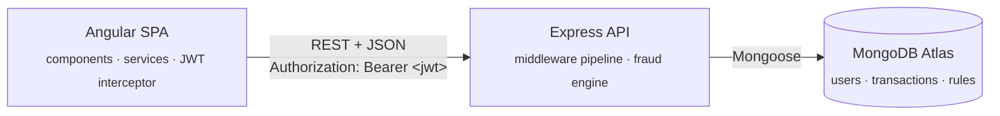
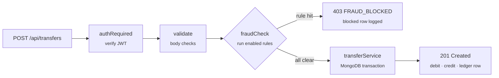

<div align="center">

# UPI Sandbox

**A UPI-style payments simulator with a live fraud rule engine.**

Send virtual rupees by UPI id. Every transfer passes through fraud rules that an admin can edit live, and the very next payment obeys them, with no restart.


</div>

> [!IMPORTANT]
> **Sandbox: fake money only.** This is a learning project. It never touches real UPI, real banks or real money.

---

## Contents

- [Features](#features)
- [How it works](#how-it-works)
- [Quick start](#quick-start)
- [Demo accounts](#demo-accounts)
- [Try this](#try-this)
- [API](#api)
- [Project structure](#project-structure)
- [Troubleshooting](#troubleshooting)

---

## Features

<table>
<tr>
<td width="33%" valign="top">

### For users
- Register / log in with JWT
- ₹1,00,000 sandbox balance to start
- Send money by UPI id with live name lookup
- One-tap recent payees
- Clear success and *blocked-with-reason* results
- History with filters, pagination, receipts and CSV export

</td>
<td width="33%" valign="top">

### Fraud engine
- **Daily limit**: total spend per IST day
- **New payee cap**: large first payment to someone new
- **Velocity**: too many transfers in a short window
- Runs as Express middleware before any money moves
- Every blocked attempt lands in an append-only ledger

</td>
<td width="33%" valign="top">

### For admins
- Edit rule limits or switch rules off, live
- **Rule simulator**: dry-run any transfer and see which rule would fire
- Blocked-attempts log
- Stats from MongoDB aggregations: blocks per rule, money moved per day

</td>
</tr>
</table>

Also: dark mode, toast notifications, skeleton loaders and a responsive layout.

---

## How it works

### Architecture



### Life of a transfer



### Design decisions

| Decision | Why |
|---|---|
| Money stored as **integer paise** (₹1 = 100) | Floating-point maths can't represent money exactly (`0.1 + 0.2 ≠ 0.3`) |
| Debit + credit inside a **MongoDB transaction** | Both happen or neither does, even if the server crashes halfway |
| **Conditional debit** (`balance >= amount` in the same update) | Parallel requests can never spend the same money twice |
| Rules read from MongoDB **on every transfer** | Admin edits apply to the very next transfer, no cache to clear |
| Rule `params` is a **flexible document** | Each rule needs a different shape (`{maxAmount}` vs `{maxCount, windowSeconds}`) |
| **Append-only** ledger | Blocked attempts stay on record for the admin, like a bank passbook |

---

## Quick start

### Prerequisites
- [Node.js](https://nodejs.org) 20 or newer
- A free [MongoDB Atlas](https://www.mongodb.com/cloud/atlas) cluster
  (a plain local `mongod` can't run transactions, which transfers need)

### 1. Clone
```bash
git clone https://github.com/jabssyyy/upi-sandbox.git
cd upi-sandbox
```

### 2. Server
```bash
cd server
npm install
cp .env.example .env    # then fill in your values (below)
npm run seed            # demo users, rules and sample transactions (safe to re-run)
npm run dev             # → http://localhost:3000
```

`server/.env`
```ini
PORT=3000
MONGODB_URI=mongodb+srv://<user>:<password>@<cluster>.mongodb.net/upi_sandbox?retryWrites=true&w=majority
JWT_SECRET=<a long random string>
JWT_EXPIRES_IN=2h
CLIENT_ORIGIN=http://localhost:4200
# DNS_SERVERS=8.8.8.8,1.1.1.1   # only if you hit "querySrv ECONNREFUSED" (see Troubleshooting)
```

> [!TIP]
> Generate a strong JWT secret with
> `node -e "console.log(require('crypto').randomBytes(48).toString('hex'))"`

### 3. Client
```bash
cd client
npm install
npm start               # → http://localhost:4200
```

---

## Demo accounts

All seeded accounts use the password **`Password@123`**. The login page also has one-click demo buttons.

| Email | Role | Notes |
|---|---|---|
| `admin@sandbox.dev` | admin | edits rules, sees the blocked log and stats |
| `priya@sandbox.dev` | user | has paid Ravi before, never Karan |
| `ravi@sandbox.dev` | user | |
| `anita@sandbox.dev` | user | |
| `karan@sandbox.dev` | user | |

---

## Try this

1. Log in as **Priya** and send **₹2,000** to `ravi@sandbox`. ✅ It goes through.
2. Send **₹25,000** to `karan@sandbox`. ⛔ *"New payee limit is ₹10,000"*
3. Log in as **admin** → **Rules** → raise the new-payee cap to **₹30,000** → Save.
   *(Optional: run the same transfer in the simulator before and after.)*
4. Back as Priya, retry the transfer. ✅ It goes through, with **no restart**.
5. Fire four quick ₹10 transfers to trigger the **velocity** rule, then check the admin **Blocked log**.

Run `npm run seed` any time to reset everything.

---

## API

All routes live under `/api` and speak JSON. Amounts are **paise**.

| Method | Path | Auth | Purpose |
|---|---|---|---|
| `POST` | `/auth/register` | – | Create an account, returns a token |
| `POST` | `/auth/login` | – | Log in, returns a token |
| `GET` | `/auth/me` | user | Current profile |
| `GET` | `/wallet` | user | Balance and today's spend |
| `POST` | `/wallet/topup` | user | Add sandbox money (max ₹50,000 per call) |
| `GET` | `/users/lookup?upiId=` | user | Receiver's name |
| `POST` | `/transfers` | user | Send money `{ toUpiId, amount, note? }` |
| `GET` | `/transfers` | user | History. Query: `status`, `from`, `to`, `page`, `limit` |
| `GET` | `/rules` | admin | List rules |
| `PUT` | `/rules/:key` | admin | Update `enabled` and/or `params` |
| `POST` | `/rules/simulate` | admin | Dry run `{ fromUpiId, toUpiId, amount }`, writes nothing |
| `GET` | `/admin/blocked` | admin | Blocked attempts, newest first |
| `GET` | `/admin/stats` | admin | Blocks per rule, volume per day |

Every error has the same shape:
```json
{ "error": { "code": "FRAUD_BLOCKED", "rule": "NEW_PAYEE_CAP", "message": "New payee limit is ₹10,000" } }
```

Ready-to-run requests for every endpoint are in [`server/requests.http`](server/requests.http) (VS Code REST Client).

---

## Project structure

```
upi-sandbox/
├── server/
│   ├── src/
│   │   ├── app.js · server.js     Express app and startup
│   │   ├── config/                env + database connection
│   │   ├── models/                User · Transaction (ledger) · Rule
│   │   ├── routes/ controllers/   REST endpoints
│   │   ├── middleware/            authRequired · requireAdmin · validate · fraudCheck · errorHandler
│   │   ├── rules/                 the fraud engine: one file per rule + index.js
│   │   ├── services/              transferService (the MongoDB transaction)
│   │   ├── events/                EventEmitter audit log
│   │   └── seed/                  demo data
│   ├── playground/                raw Node http server + callbacks demo (learning only)
│   └── requests.http              API examples
└── client/src/app/
    ├── core/                      models · services · interceptors · guards
    ├── features/                  auth · wallet · send · history · admin
    └── shared/                    nav bar · status badge · receipt · toasts · highlight directive
```

---

## Troubleshooting

| Error | Cause | Fix |
|---|---|---|
| `querySrv ECONNREFUSED` | A local DNS proxy (VPN, antivirus) refuses Node's SRV lookup | Add `DNS_SERVERS=8.8.8.8,1.1.1.1` to `server/.env` |
| `bad auth : Authentication failed` | Wrong user/password, or `<placeholders>` still in the string | Copy the string again; replace `<db_username>` and `<db_password>` including the `< >` |
| `Server selection timed out` | Your IP isn't on the Atlas allow list | Atlas → Network Access → Add Current IP Address |
| `Missing env vars: MONGODB_URI` | `.env` missing or not saved | Create `server/.env` from `.env.example` |
| `EADDRINUSE :3000` | Another server is already running | Stop it, or change `PORT` |
| *"Cannot reach the server"* in the app | The API isn't running | Start it with `npm run dev` in `server/` |

---

<div align="center">
<sub>Built with Angular, Express, MongoDB and Node.js · Sandbox only, no real money</sub>
</div>
